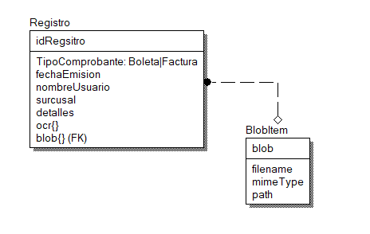

# CONSTRUIR APP UTILIZANDO FLOCI (3 servicios de - AWS)

## Servicios a utilizar: S3, DynamoDB, TextTract

### Título del proyecto: "App Automatizar gestión de comprobante"

### Consideraciones:

- Se puede desarrollar utilizando cualquier lenguaje / framework (JS -> PYTHON -> PHP -> JAVA - C#, etc.)

- El programa se ejecutará en una sola UI. En la parte superior, se mostrará un formulario que permita registrar los siguientes campos: Tipo de comprobante (Boleta - Factura), fecha emisión, nombre del usuario (persona que sube el archivo), tienda (Chincha, Pisco, Ica), observación (campo opcional), y un campo que permitirá adjuntar la imagen (formato JPG, PNG). Debajo del formulario, se deberá mostrar una tabla donde se visualice los datos agregados, debe ser posible 3 operaciones para cada registro: (1), Poder eliminar el dato, (2) Hacer una vista previa de la imagen que se adjuntó y (3) Visualizar el contenido en formato JSON obtenido (se detallará en el paso 3).

- El flujo de trabajo es el siguiente:

  - El usuario completa el formulario y adjunta una imagen
  - El primer servicio en ejecutarse es TexTract, el cual devolverá los datos del comprobante en formato JSON (simulación)
  - Una vez obtenido los datos, se almacena la imagen utilizando el servicio S3
  - Todos los datos se guardan en DynamoDB, es decir, los campos del formulario, así como el JSON que se obtuvo del análisis de la imagen.

>### ¿Cómo se presentará el trabajo? - Utilizar un formato LIBRE
>Adjuntar un solo archivo en formato PDF (3 - 5 páginas máximo) conteniendo información técnica del proyecto
Si trabaja con un compañero, indicar el nombre de los integrantes
Al final del documento, indicar el repositorio de GitHub y un enlace a un vídeo explicando el funcionamiento

### Diagrama de base datos:

### ¿Como iniciar el proyecto?

crear las tablas

- dynamoDB -> Comprobantes : id:string
- storage  -> comprobantes